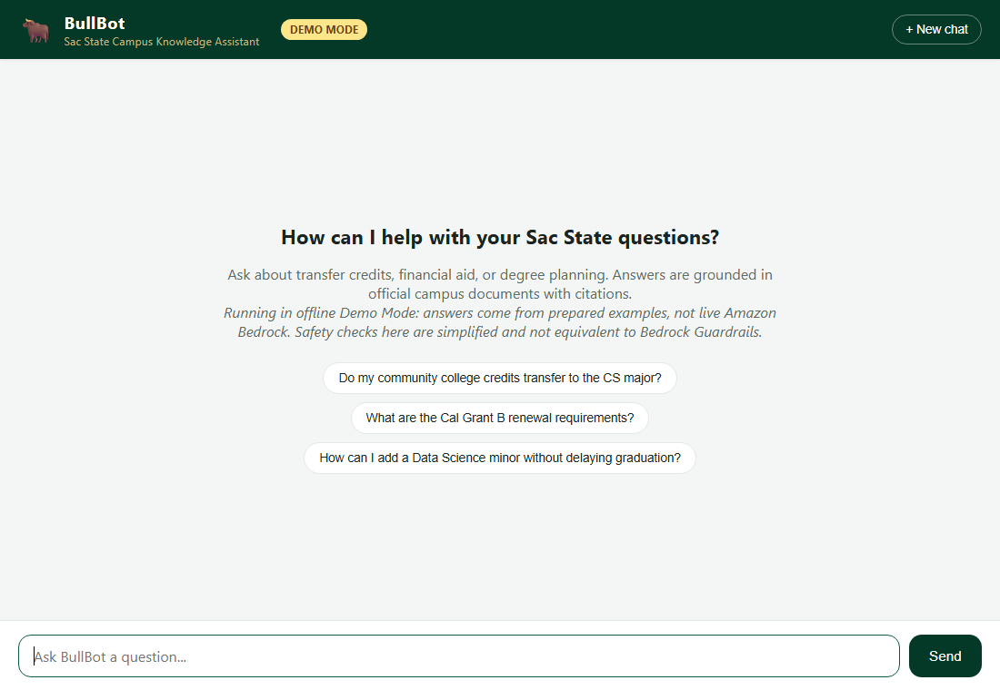
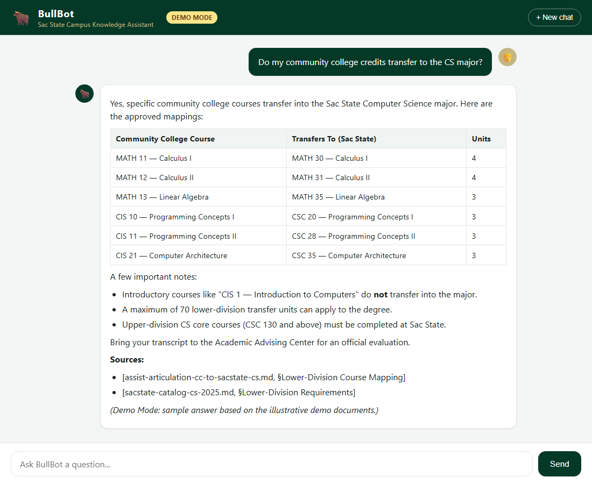

# BullBot — Campus AI Knowledge Assistant for Sac State

BullBot is a Retrieval-Augmented Generation (RAG) assistant built on Amazon Bedrock that
answers California State University, Sacramento (Sac State) students' questions about
transfer credits, financial aid, and degree planning. Every answer is grounded in campus
documents with explicit citations; when the system is not confident, it refers the student
to Academic Advising or the Financial Aid office instead of guessing. It supports English
and Spanish and screens for student PII and off-topic requests.

The project runs in two modes: an **offline demo mode** that needs no AWS account, and a
**live mode** backed by Amazon Bedrock Knowledge Bases and Guardrails.

> **Background.** I started BullBot during the YouthTechSacState Kiro Hackathon and have
> continued developing it as a personal software-engineering project. It is an independent
> portfolio project and is not affiliated with or endorsed by California State University,
> Sacramento. The bundled knowledge-base documents are illustrative placeholders, not
> official campus policy.

## Screenshots

Welcome screen (offline demo mode):



Example conversation — a grounded answer with a table and citations:



## Features

- **Grounded answers with citations** — responses cite the source document and section,
  e.g. `[financial-aid-cal-grant-b-policy.md, §Renewal Requirements]`.
- **Confidence-aware routing** — refers students to the right office when documents don't
  support a confident answer, rather than hallucinating.
- **Bilingual** — replies in English or Spanish depending on the question.
- **Safety screening** — blocks student PII (SSNs, IDs, phone, email) and off-topic
  requests. In live mode this uses Amazon Bedrock Guardrails.
- **Two operating modes** — offline demo (no AWS) and live Amazon Bedrock.
- **Lightweight web UI** — ChatGPT-style chat with Markdown, tables, loading state, error
  handling, and a "New chat" button; works on desktop and mobile.
- **Reproducible infrastructure** — idempotent `boto3` scripts build the full AWS stack.

## Technology stack

| Layer | Technology |
|-------|------------|
| Backend | Python, FastAPI, uvicorn |
| Frontend | HTML / CSS / vanilla JS (no build step); `marked` + `DOMPurify` via CDN |
| RAG orchestration | Amazon Bedrock Knowledge Bases |
| Generation model | Anthropic Claude on Amazon Bedrock (via inference profile) |
| Embeddings | Amazon Titan Text Embeddings V2 (`amazon.titan-embed-text-v2:0`, 1024-dim) |
| Vector store | Amazon OpenSearch Serverless (VECTORSEARCH) |
| Source storage | Amazon S3 |
| Safety | Amazon Bedrock Guardrails (PII, denied topics) |
| Tests / CI | pytest, GitHub Actions |

## Architecture

```
                 Browser (chat UI, Markdown + citations)
                                 |  HTTP /api/chat
                                 v
                 FastAPI backend  (web/app.py)
                                 |
                 Shared chat core (web/bullbot_core.py)
                        |                         |
           demo mode (offline)            live mode (AWS)
                        |                         |
     web/demo_responses.json         Amazon Bedrock
     (prepared sample answers)         |   RetrieveAndGenerate + Guardrail
                                       v
                        Knowledge Base (Titan V2 embeddings)
                              |                     |
                       S3 source docs        OpenSearch Serverless
```

Both modes share one code path. `bullbot_core.ask()` branches to the offline fixtures when
`BULLBOT_DEMO_MODE=1`; otherwise it calls Bedrock. The web backend and the CLI
(`scripts/bullbot_chat.py`) reuse the same core, so there is no duplicated inference logic.

Design detail (chunking strategy, vector index mapping, guardrail configuration, agent
instructions, and the build plan) lives in [`docs/specs/`](docs/specs/).

## AWS Bedrock requirements (live mode only)

Live mode calls your own AWS account — the project does not include or share any AWS
resources, and demo mode needs none of this.

- An AWS account with **Amazon Bedrock model access enabled** for Anthropic Claude (a
  generation model) and Amazon Titan Text Embeddings V2.
- Permissions for Bedrock Knowledge Bases, OpenSearch Serverless, S3, and IAM to run the
  setup scripts, plus `bedrock:RetrieveAndGenerate` and `bedrock:ApplyGuardrail` at runtime.
- Credentials supplied through your own AWS CLI session or profile (never committed).
- Running these resources incurs AWS charges; `scripts/99_teardown.py` removes them.

> Note: Amazon Bedrock Agents ("classic") is in maintenance mode and closed to new
> customers. BullBot therefore drives the Knowledge Base and Guardrail directly via
> `RetrieveAndGenerate`, which is the recommended path and needs no classic agent.

## Setup scripts (`scripts/`) — provisioning live mode

Idempotent `boto3` scripts, run in order (see `tasks.md` for details):

```
pip install -r scripts/requirements.txt
python scripts/01_create_s3_source.py
python scripts/03_create_kb_role.py
python scripts/02_create_vector_store.py <KB_ROLE_ARN>
python scripts/04_create_knowledge_base.py <KB_ROLE_ARN> <COLLECTION_ARN>
python scripts/05_create_guardrail.py
python scripts/06_create_agent.py <KB_ID> <GUARDRAIL_ID> <GUARDRAIL_VERSION>
python scripts/07_invoke_demo.py <AGENT_ID> <ALIAS_ID>
python scripts/99_teardown.py   # when done, to avoid charges
```

Set your region and resource names once in `scripts/config.py`. Put campus documents in
`docs/` before running (a sample `advising-contacts.md` is included).

## Web interface (`web/`)

A lightweight, ChatGPT-style chat UI for BullBot. It reuses the exact same Bedrock
Knowledge Base + Guardrail logic as the CLI (`scripts/bullbot_chat.py`) through a shared
core module (`web/bullbot_core.py`), so there is no duplicated inference logic and no
local AI models — all inference stays on AWS Bedrock.

- **Backend:** FastAPI + uvicorn, a single `/api/chat` endpoint.
- **Frontend:** plain HTML/CSS/JS (no build step, no `node_modules`). Markdown is rendered
  with `marked` and sanitized with `DOMPurify`, both loaded from a CDN.
- **Features:** session conversation history, Markdown (headings, lists, tables, links),
  citations/sources, loading indicator, error messages, "New chat" button, mobile-friendly.

### Operating modes

BullBot has two permanent modes:

| Mode | How to enable | What it does | AWS needed? |
|------|---------------|--------------|-------------|
| **Live** (default) | set `BULLBOT_KB_ID` + `BULLBOT_GUARDRAIL_ID` | Answers from the real Amazon Bedrock Knowledge Base, with Bedrock Guardrails for PII and topic safety | Yes — credentials + resources |
| **Demo** (offline) | set `BULLBOT_DEMO_MODE=1` | Answers from prepared examples in `web/demo_responses.json`; a "Demo Mode" badge shows in the UI | **No** — makes zero AWS calls |

Demo mode exists so anyone can run and evaluate the project without an AWS account, and so
the UI stays demonstrable after temporary credentials expire. **Important:** demo mode's
safety checks are simple keyword matches and are **not** equivalent to Amazon Bedrock
Guardrails — they are for demonstration only. Prepared answers are either real Bedrock
captures or clearly-labeled sample content, and all citations point to the illustrative
placeholder documents in `docs/`.

### Requirements

- Python 3.10+ with the existing project virtualenv (reuse it — do not create a new one).
- Backend deps (installed once): `pip install -r web/requirements.txt`
  (`boto3` is already provided by `scripts/requirements.txt`).
- **Live mode only:** valid AWS credentials in your shell (via `aws login` / an AWS
  profile). The app never stores or exposes credentials. Demo mode needs none.

### Environment variables

The backend reads configuration from env vars only (see `web/.env.example`). No AWS
credentials go here — those come from your AWS CLI session.

| Variable | Meaning | Example |
|----------|---------|---------|
| `BULLBOT_DEMO_MODE` | Set to `1` for offline demo mode | `1` |
| `BULLBOT_KB_ID` | Knowledge Base ID (live mode) | `your-kb-id` |
| `BULLBOT_GUARDRAIL_ID` | Guardrail ID (live mode) | `your-guardrail-id` |
| `BULLBOT_GUARDRAIL_VERSION` | Guardrail version, never `DRAFT` (live mode) | `1` |
| `AWS_REGION` | AWS region (live mode) | `us-east-1` |

In live mode, get the KB ID from the output of `scripts/04_create_knowledge_base.py` (or the
Bedrock console) and the guardrail ID from `scripts/05_create_guardrail.py`.

### Start in demo mode (no AWS)

```powershell
$env:BULLBOT_DEMO_MODE="1"
python -m uvicorn app:app --host 127.0.0.1 --port 8000
```

### Start in live mode (AWS Bedrock)

```powershell
$env:BULLBOT_KB_ID="your-kb-id"
$env:BULLBOT_GUARDRAIL_ID="your-guardrail-id"
$env:BULLBOT_GUARDRAIL_VERSION="1"
$env:AWS_REGION="us-east-1"
python -m uvicorn app:app --host 127.0.0.1 --port 8000
```

Run both from the `web/` folder, then open http://127.0.0.1:8000 in a browser.

> Do **not** add `--reload` — the file watcher wastes CPU and is unnecessary for a demo.

### Stop the web interface

Press `Ctrl+C` in the terminal running uvicorn. That shuts the server down cleanly with
no lingering background process. (A closed socket may show briefly in `TIME_WAIT`; the OS
releases it within a minute.)

### Troubleshooting

| Symptom | Fix |
|---------|-----|
| `503 Server not configured` | Live mode needs `BULLBOT_KB_ID` + `BULLBOT_GUARDRAIL_ID`, or set `BULLBOT_DEMO_MODE=1` for offline mode. |
| `502 could not reach knowledge service` | AWS credentials expired — run `aws login`. Check the server log line for detail. |
| `504 took too long` | Bedrock was slow; retry. Timeout is 60s (`REQUEST_TIMEOUT_SECONDS` in `app.py`). |
| Answers look like raw `*asterisks*` | Markdown libs blocked by a strict network; they load from jsDelivr CDN. |
| Port 8000 in use | Another server is running, or a socket is in `TIME_WAIT` — wait a minute or use `--port 8001`. |

### Keeping resource usage low

- Reuse the existing virtualenv and installed packages — don't reinstall dependencies.
- Run **one** server at a time; never use `--reload` or multiple dev servers.
- No local AI models are used; inference is on Bedrock, so RAM/CPU stay low
  (the server idles around ~80 MB RAM).
- `.vscode/settings.json` excludes `.venv`, `__pycache__`, and logs from IDE indexing and
  file watching to cut editor RAM/CPU/SSD usage.
- The backend caps input length (2000 chars) and request time (60s), and bounds the
  in-memory session store, so a single process stays small.

### Tests

Tests run entirely offline in demo mode — no AWS credentials or network required. They also
assert that no AWS client is ever created in demo mode.

```powershell
pip install -r requirements-dev.txt
python -m pytest tests/ -v
```

## Limitations

- **Demo content is illustrative.** The knowledge-base documents in `docs/` are synthetic
  placeholders, not official Sac State policy. Do not rely on them for real decisions.
- **Demo-mode safety is not Bedrock Guardrails.** Offline mode uses simple keyword matching
  for PII and off-topic screening — a demonstration only, not equivalent to the real
  Guardrails used in live mode.
- **Demo mode answers a fixed set of questions.** Anything outside the prepared scenarios
  returns a fallback message.
- **Live mode depends on your AWS account**, model access, and credentials, and incurs cost
  while resources exist.
- **Not an official advising tool.** BullBot supplements, and does not replace, Academic
  Advising or the Financial Aid office.

## Project background

BullBot began at the YouthTechSacState Kiro Hackathon and is maintained as an individual
portfolio project exploring RAG, grounded generation with citations, and AI safety
guardrails on AWS. It demonstrates end-to-end work: infrastructure-as-code, a reusable
Python core, a web UI, offline/online operating modes, and automated tests.

## License

Released under the [MIT License](LICENSE). Copyright (c) 2026 Ivan Librado.
